<h1 align="center">
  <a href="https://nicolascaous.github.io/slopbuckets/"></a>
</h1>

<p align="center">
  <a href="https://www.npmjs.com/package/slopbuckets"></a>
  <a href="https://github.com/NicolasCaous/slopbuckets/actions/workflows/ci.yml"></a>
  <a href="https://github.com/NicolasCaous/slopbuckets/blob/main/LICENSE"></a>
  <a href="https://www.npmjs.com/package/slopbuckets"></a>
</p>

<p align="center">
  <a href="https://nicolascaous.github.io/slopbuckets/"><b>Website</b></a>
  &nbsp;&nbsp;|&nbsp;&nbsp;
  <a href="https://nicolascaous.github.io/slopbuckets/docs/"><b>Docs</b></a>
  &nbsp;&nbsp;|&nbsp;&nbsp;
  <a href="https://nicolascaous.github.io/slopbuckets/docs/guide/getting-started.html"><b>Getting started</b></a>
  &nbsp;&nbsp;|&nbsp;&nbsp;
  <a href="https://www.npmjs.com/package/slopbuckets"><b>npm</b></a>
</p>

slopbuckets is a CLI for TypeScript and JavaScript projects that AI agents edit. The architecture of the project lives in one file, `buckets.config.json`. It lists the buckets, which are groups of files with one job each, what each bucket does, which buckets and npm packages each one imports, and a one-line reason for every one of those imports. Hooks in the coding agent stay silent while the code follows the file. When an edit makes the code diverge, the hook shows the agent the problem with two fixes, one in the code and one in the config.

Both fixes are valid, and no human approves anything. The agent picks the fix that fits its task and writes down why, and the next agent reads that reason before it changes the same code.

```sh
npm install -g slopbuckets
```

## What it is and what it is not

slopbuckets is:

- one JSON file that holds the whole architecture explicitly, with no defaults, tags or wildcards;
- hooks for 17 coding agents that check each edit while the agent works, and a `buckets check` command for CI and a git pre-commit hook;
- a record of decisions. The git history of `buckets.config.json` is the history of the architecture, with a reason on every line.

slopbuckets is not:

- an ESLint plugin. It does not run in the editor or in `eslint`, and it does not replace your linter;
- a gate that humans control. An agent may change the architecture as freely as the code. If you want a person to own the rules, see [if you know another tool](https://nicolascaous.github.io/slopbuckets/docs/guide/coming-from.html);
- a tool that writes the config for you. `buckets init` writes an empty config, and your agent designs the buckets;
- a check of coupling without imports. Two buckets that share a database table pass the check.

## Why

An AI agent solves each task by the shortest path, and the shortest path is usually an import from some other part of the project. After a few hundred tasks, every module depends on every other module, and nobody remembers why.

The next agent has no way to tell a decision from an accident. It reads the code, sees an import from `billing` into `log` and copies the pattern. slopbuckets writes the decisions down where every agent reads them, with a purpose for each bucket and a reason for each dependency. The hooks keep the code and that file in agreement, so the file stays true.

## How other tools differ

[Nx module boundaries](https://nx.dev/features/enforce-module-boundaries), [eslint-plugin-boundaries](https://github.com/javierbrea/eslint-plugin-boundaries), [Sheriff](https://github.com/softarc-consulting/sheriff) and [dependency-cruiser](https://github.com/sverweij/dependency-cruiser) also check which part of a TypeScript project may import which. They differ from slopbuckets in three ways:

| | Nx, boundaries, Sheriff, dependency-cruiser | slopbuckets |
|---|---|---|
| Rules | Patterns, tags or regular expressions, where one rule covers many imports | One entry per pair of buckets and per package, each with a reason |
| Who changes the rules | A human, usually through code review of the rules file | The agent, as an answer to the hook, with no approval |
| When it reports | In the editor, in `eslint` or in CI, after the code is written | In the agent at each edit and at the end of each turn, and in CI |

None of these tools asks for a reason per dependency, and none tells the agent that changing the rules is a valid fix. [If you know another tool](https://nicolascaous.github.io/slopbuckets/docs/guide/coming-from.html) maps the concepts of each one to slopbuckets and says when to keep the tool you have.

## How it works

### Buckets

A bucket is a set of files with one job, matched by globs. A glob that starts with `!` leaves files out. Every file is in exactly one bucket or in `ignore`, the list of files outside the architecture, such as tests and scripts.

```json
{
  "$schema": "https://nicolascaous.github.io/slopbuckets/schema/v2.json",
  "version": "2.0",
  "ignore": ["**/*.test.ts", "scripts/**"],
  "projects": ["packages/sdk"],
  "buckets": {
    "billing": {
      "purpose": "Issues and charges invoices",
      "files": ["src/billing/**", "!src/billing/stripe/**"],
      "public": "src/billing/index.ts",
      "dependsOn": {
        "payments": "Charges go through the gateway",
        "log": "Logs failed charges with the invoice id"
      },
      "packages": {
        "zod": "Validates the invoice payloads of the public API"
      }
    },
    "payments": {
      "purpose": "Talks to the payment gateway",
      "files": ["src/payments/**"],
      "public": "src/payments/index.ts",
      "dependsOn": {},
      "packages": {}
    }
  }
}
```

Each bucket has five required fields: `purpose`, `files`, `public`, `dependsOn` and `packages`. `version` is the version of the config format, and `projects` lists the folders of nested projects, each with its own config.

### Public files

`public` names the files other buckets may import: one path, a list of paths, or `null`. A public file holds only named re-exports, such as `export { charge } from './client'`, so it shows the whole interface of the bucket, and the rest of the bucket can change without breaking anyone. Use a list when a bucket has separate entries, such as a server entry and a client entry. `"public": null` declares a bucket that exports nothing, such as an app entry point.

### Dependencies and packages

`dependsOn` lists the buckets a bucket may import, and `packages` lists every npm package and Node built-in it imports, such as `zod` or `node:fs`. Every entry has a one-line reason. There is no wildcard and no default, so a `log` bucket used by 50 buckets needs 50 entries, and each one says why. A dependency or package that no file imports is reported too, so a stale reason never stays in the file. A cycle in `dependsOn` is a violation, and since code can only follow declared dependencies, the code has no cycles between buckets either.

### Hooks

`buckets init` installs hooks in your coding agent. Before each edit, the hook simulates the edit in memory and checks it against the config. With nothing to report it prints nothing, so a session that follows the config costs no tokens. When the edit diverges, the hook adds the pending list to the agent's context. Here an agent wrote `src/billing/refund.ts` with an import of a private file of `payments`:

```text
buckets: 1 pending. Fix the code or edit buckets.config.json. Either is valid. Full detail: buckets check

[NEW]
billing -> payments: private file
  src/billing/refund.ts:1 imports charge from src/payments/client.ts
  payments public: src/payments/index.ts
  fix code: import from src/payments/index.ts instead
```

A few edits into a session, the list can hold three sections. The same agent then added a file in no bucket, and then rewrote `refund.ts` to import `payments` through its public file and to import `log`, which `billing` does not declare. The image is the real hook output for that third edit:

<p align="center"> log: undeclared dependency in full, with both purposes, the reason app gives for its own dependency on log, the choose one fix line and the fix code and fix config lines; under [OLD], src/utils/date.ts: in no bucket; under [RESOLVED], billing -> payments: private file (src/billing/refund.ts:1)."></p>

The list shows before every later tool call until it is empty. A new violation shows in full once, then as a one-line reminder under `[OLD]`, and a fixed one shows once under `[RESOLVED]`. At the end of the turn, the stop hook runs the full check and blocks once if anything is left.

## The loop

1. The hook warns. An agent writes an import that the config does not allow, and the pending list says so, with both fixes.
2. The agent decides. It knows the task, so it knows whether the import is a mistake or a sign that the architecture should change. The hook never prefers one answer.
3. The agent writes the reason. If it keeps the import, it declares the dependency with a one-line reason, such as `"log": "Logs failed charges with the invoice id"`.

Months later, a third agent opens the config, reads that reason and knows why `billing` depends on `log`.

## Quick start

```sh
npm install -g slopbuckets
cd your-project
buckets init
```

`init` prints what it set up. In a git repository with a `tsconfig.json`:

```text
Setting up slopbuckets in /home/you/your-project

  + Created buckets.config.json with no buckets
  + Created .gitignore with .buckets/
  + Installed Claude Code hooks in .claude/settings.json (PreToolUse, Stop, SubagentStop, PostCompact)
  + Installed the skill in .claude/skills/slopbuckets/SKILL.md
  + Created AGENTS.md with the slopbuckets rules for every agent
  + Installed the skill for other agents in .agents/skills/slopbuckets/SKILL.md
  + Created .gitattributes so git merges buckets.config.json with buckets merge-driver
  + Set merge.slopbuckets.driver in the git config of this clone. Each clone needs it once: run `buckets init` there too.

Next: let your agent design the buckets in buckets.config.json. Every file starts as unowned, and `buckets check` lists them grouped by folder.

Paste this prompt into your coding agent:

  slopbuckets is set up in this project. Build its first architecture as the section "The first architecture after buckets init" of .agents/skills/slopbuckets/SKILL.md says, and run `buckets check` until it exits with 0.
```

The skill is a Markdown file that teaches the agent how to read and edit the config. The merge driver lets git merge two branches that each add a bucket or a dependency without a conflict. Right after `init`, `buckets check` exits with 1 and lists every file as in no bucket, grouped by folder. Paste the prompt into your agent, and it designs the first buckets and runs the check until it exits with 0.

Requires Node.js 20 or newer and a `tsconfig.json`, which a JavaScript project needs too. The project does not need the `typescript` package. slopbuckets uses the project's TypeScript 5 or 6 when it has one, and otherwise the TypeScript 6 it installs with itself. See [getting started](https://nicolascaous.github.io/slopbuckets/docs/guide/getting-started.html).

## The costs of adoption

slopbuckets asks for more writing than a rule file with patterns. Before you adopt it, know what it takes:

- Every bucket declares every package it imports, Node built-ins included, with a reason. A bucket that imports `react`, `zod` and `node:fs` needs three entries, and type-only imports count.
- Every dependency between buckets needs its own entry and reason. A `log` bucket used by 50 buckets needs 50.
- Every bucket needs a public file of named re-exports, and imports of private files must move to it. `buckets fix import-private` writes the re-exports and rewrites those imports.
- Every file must be in a bucket or in `ignore`.
- During the first architecture, the pending list can be long, and the hook repeats it as one-line reminders before every tool call until it is empty.
- The install is about 24 MB, nearly all of it the TypeScript 6 that the CLI depends on. A project on TypeScript 5 keeps its own compiler too, so the two take about 48 MB.
- A pull request that changes the architecture changes `buckets.config.json`. `buckets check --base main` lists the buckets, dependencies, packages and public exports that changed, with their reasons, so a reviewer reads the decisions instead of the raw JSON.

[The costs of adoption](https://nicolascaous.github.io/slopbuckets/docs/guide/costs.html) has the details and what each cost buys.

## Rules

| Rule | What it detects |
|---|---|
| `config-invalid` | the config is not valid JSON, misses a required field, has an empty reason, names a bucket that does not exist or names a package by a subpath |
| `config-cycle` | a cycle in the `dependsOn` graph |
| `dependency-undeclared` | a file of bucket A imports bucket B, and `A.dependsOn` does not list B |
| `dependency-unused` | `A.dependsOn` lists B, and no file of A imports B |
| `import-private` | an import of a file of B that `B.public` does not list, or of any file of B when its `public` is `null` |
| `import-unresolved` | a relative import, an import that matches a `paths` pattern of `tsconfig.json`, or an import of a workspace package does not resolve to a file |
| `import-ignored` | a file of a bucket imports an ignored file |
| `import-dynamic` | `import()` or `require()` with an argument that is not a string literal |
| `import-namespace` | `import * as x`, `export * from` or `import()` without destructuring points at another bucket |
| `file-unowned` | a file in no bucket and not in `ignore` |
| `file-overlap` | a file in two or more buckets |
| `glob-empty` | a glob of `files` or `ignore`, or a path of `projects`, that matches nothing |
| `public-missing` | a file that `public` lists does not exist or does not belong to the bucket |
| `public-not-interface` | a public file has code, uses `export *` or re-exports from another bucket |
| `project-undeclared` | a nested `buckets.config.json` not listed in `projects` |
| `export-unused` | a name in a public file that no other bucket imports |
| `package-undeclared` | a file of a bucket imports an npm package or a Node built-in that its `packages` does not list |
| `package-unused` | `packages` lists a package that no file of the bucket imports |

Before each tool call, `config-invalid` interrupts. An edit that makes the config worse is denied and never reaches the disk, because with an unreadable config no other rule can run. A config that a merge or a shell command already broke shows in the pending list instead. Every other rule warns and lets the tool run. At the end of the turn, every rule interrupts. The [rules reference](https://nicolascaous.github.io/slopbuckets/docs/reference/rules.html) has every message.

`buckets check` prints the same messages for agents, CI and the git hook. Its exit codes:

| Code | Meaning |
|---|---|
| 0 | Every rule passes. |
| 1 | A rule is broken. Fix the code or edit `buckets.config.json`. |
| 3 | Environment problem, such as a missing config or a config written for a newer slopbuckets. |
| 64 | The command line is wrong, such as an unknown option. Every command exits with 64 for that and prints its usage. |

So a typo such as `buckets check --jsno` in CI exits with 64, and nobody reads it as "found violations". This is the check after the agent session above:

<p align="center"></p>

## CI

Add slopbuckets as a dev dependency, so every machine runs the same version, and run the local copy:

```yaml
- run: npm ci
- run: npx buckets check
```

The check fails the job on any violation, whoever wrote the change. On GitHub Actions it also prints `::error` annotations, which GitHub shows on the lines of the pull request, and `--format sarif` prints a SARIF log for code scanning. `buckets init --git-hook` installs a git pre-commit hook that runs the check. See the [CI guide](https://nicolascaous.github.io/slopbuckets/docs/guide/ci.html).

## Config

| Field | Required | Meaning |
|---|---|---|
| `version` | yes | the version of the config format, `"2.0"`, as `init` writes it |
| `buckets` | yes | the buckets, keyed by name |
| `buckets.<name>.purpose` | yes | one line that says what the bucket does |
| `buckets.<name>.files` | yes | globs of its files; a leading `!` excludes |
| `buckets.<name>.public` | yes | the file or list of files other buckets may import, or `null` |
| `buckets.<name>.dependsOn` | yes | bucket name to a one-line reason; `{}` for none |
| `buckets.<name>.packages` | yes | npm package or Node built-in to a one-line reason; `{}` for none |
| `buckets.<name>.external` | no | one line naming the code outside the project that uses the public files, such as the entry of an npm package |
| `ignore` | no | globs of files outside the architecture, such as tests and scripts |
| `projects` | no | folders of nested projects, each with its own `buckets.config.json` |

The check reads the files that git lists, so `.gitignore` applies. It applies `ignore` before the bucket globs, so an ignored file never conflicts with a bucket. `buckets show <bucket>` prints one bucket with its dependents and violations, and `buckets fmt` writes the config in a fixed key order. See the [config reference](https://nicolascaous.github.io/slopbuckets/docs/reference/config.html) and [nested projects](https://nicolascaous.github.io/slopbuckets/docs/guide/nested-projects.html).

## Agents

"Warning on edit" means the agent gets the pending list before the edit runs. "After the edit" means the agent cannot take context before a tool runs, so the warning arrives with the result of the edit. "Interrupt at the end" means the stop hook can block the end of the turn. "Compaction" means the hooks know when the agent compacts its context, and show every item in full again.

| Agent | Warning on edit | Interrupt at the end | Subagents | Compaction |
|---|---|---|---|---|
| Claude Code | yes | yes | yes | yes |
| Codex CLI | yes | yes | yes | yes |
| Qwen Code | yes | yes | yes | yes |
| GitHub Copilot | yes | yes | partial | no |
| Pi | yes | yes | no | yes |
| Cursor | after the edit | yes | yes | no |
| Factory Droid | after the edit | yes | unverified | yes |
| Gemini CLI | after the edit | yes | no | no |
| Auggie | after the edit | yes | no | no |
| Devin | after the edit | yes | no | yes |
| Amp | after the edit | yes | unverified | no |
| OpenCode | after the edit | partial | yes | yes |
| Cline | yes | no | no | no |
| Crush | yes | no | no | no |
| Goose | no | yes | unverified | no |
| Kiro | partial | partial | no | no |
| Aider | partial | no | no | no |

`buckets init --agent <name>` sets up one agent, and `--agent auto` sets up every agent whose folder or file is in the project, such as `.codex` or `GEMINI.md`. Windsurf gets one hook, which refuses an edit that breaks the config and shows no pending list. Zed, Continue and other agents get no hooks. These agents follow the `AGENTS.md` block, which tells the agent to run `buckets check` before it finishes, and the git hook and CI catch the rest. See [supported agents](https://nicolascaous.github.io/slopbuckets/docs/guide/agents/).

## Inspect

`buckets inspect` serves a read-only page on `127.0.0.1` for the human. It has a layered graph of the buckets, a dependency matrix, the pending violations, the file tree and a details panel that shows the reason and the imports behind each dependency. Every selection goes into the URL, and the page marks what the agents changed while it was open.

<p align="center"><a href="https://nicolascaous.github.io/slopbuckets/demo/"></a></p>

Try it on the [live demo](https://nicolascaous.github.io/slopbuckets/demo/), a static export of the page for a generated shop with 31 buckets, a nested project and a few pending items.

`buckets inspect --json` prints the same state for agents and scripts, and `--export svg|mermaid|dot|html` prints the graph or the whole page without a server. See the [inspect guide](https://nicolascaous.github.io/slopbuckets/docs/guide/inspect.html).

## What the check cannot see

The check follows imports. Two buckets that share a database table, an event topic or an environment variable are coupled without an import, and the check passes. One bucket with `src/**` also passes every rule while it says nothing about the architecture. Read the config your agents write. See [what the check guarantees](https://nicolascaous.github.io/slopbuckets/docs/guide/guarantees.html).

## Performance

The hooks run before every tool call, so the check never loads the TypeScript type checker. A light scanner reads the imports, `ts.resolveModuleName` resolves them with your `tsconfig.json`, and a cache in `.buckets/cache/` keeps both between runs. The pre-edit hook scans only the edited file.

| Operation | Repository | Budget | Median / p95 |
|---|---|---|---|
| pre-edit hook, warm cache | 10,000 files | p95 under 150 ms | 81 / 89 ms |
| pre-edit hook, warm cache | 50,000 files | p95 under 150 ms | 119 / 130 ms |
| pre-tool hook, no simulation | 10,000 files | under 80 ms | 56 / 69 ms |
| stop hook, warm cache, 20 files changed | 10,000 files | under 300 ms | 187 / 204 ms |
| `buckets check`, cold | 10,000 files | under 2 s | 1,023 / 1,075 ms |

The times include starting Node, measured on Windows 11 with an Intel Core i9-13900KF. See [performance](https://nicolascaous.github.io/slopbuckets/docs/guide/performance.html) for the machine and every scenario.

## Repository layout

```
cli/             the buckets command, published to npm as slopbuckets
adapters/ts/     TypeScript adapter, bundled into the CLI
examples/        end-to-end cases that run the built CLI
skill/           the skill buckets init installs
docs/            documentation site (VitePress), built into site/docs/
site/            website and config schemas, served by GitHub Pages
bench/           baseline.json, the medians the benchmark compares against
scripts/         bench.mjs, the benchmark; stress-project.mjs, which generates its projects;
                 readme-assets.mjs, which draws the images in .github/readme/; site-demo.mjs,
                 which exports the inspect demo of the website
```

## Development

```sh
npm ci
npm run build
npm test                 # unit tests
npm run test:examples    # builds the CLI and runs every case in examples/
npm run typecheck
npm run docs:dev         # serves the docs site locally
npm run docs:build       # builds the docs into site/docs/
npm run readme:assets    # redraws the README images from the real CLI output
npm run bench            # measures the hooks and the check against the budgets
```

`npm run readme:assets` takes the screenshot of `buckets inspect` with a local Chrome or Edge. Set `CHROME_PATH` if it is not in the usual place.

## License

[MIT](https://github.com/NicolasCaous/slopbuckets/blob/main/LICENSE)
